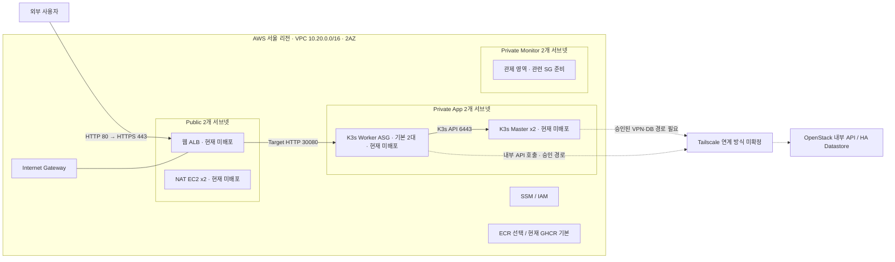

# DURIAN AWS 인프라 구축·검토 인수인계서

> **기준일:** 2026-11-20 (KST)  
> **프로젝트:** OpenStack–AWS 하이브리드 클라우드 DevSecOps 보안 플랫폼  
> **작성 범위:** AWS 인프라 Terraform 코드, 기존 적용 상태, K3s/ALB/배포 준비, 팀 연동 이슈  
> **담당:** AWS 인프라(이성민) / 리뷰: 재우님 및 관련 파트 담당자  
> **기준 저장소:** [`ktcloud-durian/durian-infra`](https://github.com/ktcloud-durian/durian-infra)  
> **기준 브랜치:** [`review/aws-k3s-team-integration-20261120`](https://github.com/ktcloud-durian/durian-infra/tree/review/aws-k3s-team-integration-20261120)  
> **확인한 최신 커밋:** `2e7d93f` (`fix(aws): remove unused K3s master SSM write permission`)

## 0. 먼저 읽을 요약

- **실제 AWS에 확인된 기반 리소스:** 기존 VPC, IGW, Public/Private 서브넷과 라우팅 테이블, 기존 `durian-k3s` EC2 및 기존 IAM/SG 등이 Terraform State 조회에 나타남.
- **Terraform 코드로 준비한 신규 영역:** AWS K3s Master 2대/Worker ASG 기본 2대, NAT EC2 AZ당 1대, 웹 ALB, HTTPS 리디렉션, Route 53 연계, ECR 선택 지원, WAF, S3 웹 에셋, Master/Worker IAM·SSM, 설치 스크립트.
- **중요:** 신규 K3s, NAT, ALB, WAF 등은 **기본적으로 비활성화**. 실제 구축 완료나 웹 서비스 가동을 뜻하지 않는다.
- **최근 검증:** `terraform fmt` / `terraform validate` 정상, `terraform plan` 결과 **33 to add, 0 to change, 0 to destroy**. 이 33개는 신규 IAM Role/Profile, SG 및 SG 규칙 등 **여전히 생성 계획에 남는 리소스**다. **`terraform apply`는 실행하지 않았다.**
- **팀 승인 대기:** OpenStack HA Datastore, Tailscale Relay/ACL, K3s 등록용 안정적 엔드포인트, Argo CD GitOps 경로, 이미지 레지스트리, ALB 인증서/도메인/헬스체크, 보안 최종 승인.
- **리뷰 목표:** 코드를 팀이 먼저 검토하고 AWS 비용·보안 영향이 있는 배포는 별도 승인 후 진행.

### 상태 표시 원칙

| 구분 | 의미 |
|---|---|
| **기존 구축/조회 확인** | Terraform Plan의 State refresh에서 조회된 리소스. 정상 서비스 동작까지 검증한 뜻은 아님 |
| **코드 구현/미배포** | GitHub에 Terraform·스크립트가 있으나 실제 AWS 생성/작동은 검증하지 않음 |
| **검토·합의 필요** | 다른 파트나 보안 승인 없이 설정·배포를 확정하면 안 됨 |

## 1. 목표 아키텍처 및 데이터 흐름

**원칙:** 외부 사용자 웹 트래픽은 AWS가 처리하고, 민감한 내부 API/DB는 OpenStack 영역에 남긴다. AWS 웹 노드에서 **고객 DB 3306 직접 접속을 허용하는 설계가 아니다.** 온프렘 내부 서비스 호출은 승인된 API 경유를 원칙으로 한다.



> 위 그림은 **현재의 실제 운영 토폴로지와 미래 목표를 섞지 않도록** 미배포를 명시한 개념도다. Tailscale 연결·OpenStack HA DB는 확정된 네트워크 설계가 아니라 **검토 대상**이다.

## 2. AWS 네트워크 구성

### 2.1 VPC·AZ·서브넷

| 항목 | AZ `ap-northeast-2a` | AZ `ap-northeast-2c` | 용도 |
|---|---|---|---|
| VPC | \- | `10.20.0.0/16` | 모든 AWS 리소스가 속하는 네트워크 |
| Public | `10.20.0.0/24` | `10.20.1.0/24` | ALB·NAT EC2 배치 예정 |
| Private App | `10.20.10.0/24` | `10.20.11.0/24` | K3s Master·Worker 배치 예정 |
| Private Monitor | `10.20.20.0/24` | `10.20.21.0/24` | 모니터링·관리 영역 예정 |
| Public RT | 공통 Public RT → IGW | 공통 Public RT → IGW | 인터넷 공개 서브넷 |
| Private RT | AZ별 개별 RT | AZ별 개별 RT | NAT 활성화 전에는 기본 인터넷 경로 없음 |

- **구현:** `main/vpc.tf`, `main/variables.tf`.
- **상태:** VPC·6개 서브넷·IGW·RT/연결이 최근 Plan에서 refresh됨. 설계 CIDR은 Terraform 변수로 계산됨.
- **주의:** NAT가 꺼진 지금 Private App/Monitor 서브넷의 인터넷 다운로드 경로는 **열리지 않음**. K3s 설치·SSM 사용에 필요한 NAT 또는 승인된 VPC Endpoint 등은 배포 전 확보해야 한다.

### 2.2 NAT EC2

- **설계:** `main/nat.tf` + `main/scripts/nat.sh.tftpl`, AZ별 `t3.micro` 1대(총 2대), Public Subnet, IP Forwarding + iptables MASQUERADE, `source_dest_check=false`, 암호화 GP3 10GiB.
- **이번 개선:** `nat_enabled=false` 기본값을 추가하고 NAT EC2, Private 0/0 Route, NAT SG 입·출력 규칙을 조건부 생성.
- **현재:** NAT EC2 **0대 생성 계획**. 단, `durian-nat-sg`라는 **SG 자체는** 별도 역할 SG 코드에 남아 있음.
- **가동 전 확인:** 보안 담당 Egress/Ingress 검토, 비용, NAT 단일 장애 및 AZ 단위 장애 복구, Public IP/트래픽 비용, Private 서브넷 외부 통신 필요성.

## 3. EC2 및 K3s 구조

### 3.1 기존 EC2와 신규 클러스터를 구분

| 항목 | 기존 EC2 | 신규 K3s 설계 |
|---|---|---|
| 리소스 | `aws_instance.this["k3s"]` | `aws_instance.k3s_master` + Worker ASG |
| 확인된 상태 | State refresh에서 기존 인스턴스 조회 | 신규 인스턴스 미배포 |
| AMI | `ami-0427d6051617172b0`를 기본 변수에서 지정 | Canonical Ubuntu 24.04 SSM 최신 AMI 참조 |
| 인스턴스 타입 | `m7i-flex.large` 기본값 | Master `t3.medium`, Worker `t3.small` 초안 |
| 배치 | 기본적으로 첫 Public Subnet | Private App 2개 AZ |
| 관리 | 기존 IAM/SSM | 역할별 IAM/SSM |
| 주의 | 기존 K3s EC2는 **새로운 2+2 HA 구성에 자동 합류하지 않음** | 팀 승인 및 HA 저장소 확정 후 구축 |

- 기존 EC2는 `main/ec2.tf`, `main/variables.tf`에서 관리. `ami_id`를 지정하면 기존 User Data는 실행하지 않는 코드다.
- 이번 검토에서 **EC2 `prevent_destroy` 추가는 생략**했다. 삭제/교체 방지를 위해 매번 Plan 검토와 팀 승인 절차를 사용한다.
- 기존 EC2 Public IP가 Plan `Outputs`에서 빈 값으로 바뀌는 것은 조회 당시 IP 상태의 출력 차이이며, 이 Plan에 **EC2 변경·삭제 작업은 없음**.

### 3.2 신규 K3s Master / Worker

| 부분 | 설계·현재 코드 | 상태 |
|---|---|---|
| Master | 2AZ에 기본 2대, Private App, `t3.medium`, 암호화 EBS 30GiB, IMDSv2 | 비활성화 |
| Worker | ASG `min=desired=2`, `max=desired+1`, `t3.small`, Private App AZ 2개 사용 | 비활성화 |
| Network | K3s API TCP 6443, VXLAN UDP 8472, Kubelet TCP 10250 | SG 코드 준비 |
| Pod/Service CIDR | `10.52.0.0/16` / `10.53.0.0/16` | 초안 값 |
| 외부 웹 연결 | Worker Traefik NodePort 30080 | 코드 준비 |
| 운영 가드 | `aws_k3s_enabled=false`, `aws_k3s_bootstrap_approved=false`, `aws_k3s_datastore=pending`, 고정 K3s 버전 요구 | 배포 차단 |
| Datastore | 현재 guard는 **external**만 승인 허용. OpenStack 측 MariaDB HA와 CA 파일 필요 | 미확정 |

- 파일: `main/k3s-config.tf`, `main/k3s-master.tf`, `main/k3s-worker.tf`, `main/k3s-deploy-guard.tf`, `main/k3s-userdata.tf`.
- Master 수 1~2대 정수 검증을 추가했고, Worker 수는 **1 이상의 정수만** 허용하여 향후 4대 이상도 코드상 가능하게 했다. 기본 2대는 유지.
- **주의:** Worker 숫자 검증을 완화한 것이 HPA/Cluster Autoscaler/ASG 자동 확장 정책을 만든 것은 아니다. 현재 ASG는 `desired + 1`이 최대이고, AZ당 1대 배치를 보장하는 별도 강제 규칙도 확인되지 않는다.
- **중요:** Master 2대만 있다고 HA가 완성되지 않는다. 외부 DB의 HA·접속 경로·인증서·Master 등록 엔드포인트가 모두 필요하다.

### 3.3 K3s 초기 설정 스크립트 (검토용)

| 스크립트 | 역할 |
|---|---|
| `scripts/k3s-userdata.sh.tftpl` | 부트스트랩 파일 스테이징, 승인 시에만 설치 실행 |
| `scripts/run-k3s-bootstrap.sh` | AWS CLI/SSM, 버전·권한·토큰·DB CA·Tailscale 선행 검사 |
| `scripts/team-node-prep.sh` | 시간 동기화, Node Exporter, Tailscale 준비 로직 포함 |
| `scripts/install-k3s-ha-master.sh` | HA Master 설치 초안, 외부 MariaDB Datastore 요구 |
| `scripts/install-k3s-ha-worker.sh` | SSM 등록 엔드포인트·Agent Token으로 Worker 가입 초안 |
| `scripts/traefik-config.yaml` | Traefik 웹 NodePort `30080` |
| `scripts/install-argocd-gitops.sh` | HA Master 2대 Ready 후 Argo CD 수동/승인 설치 |

**미해결:** 현재 Master가 자체 Tailscale에 직접 가입하도록 설계된 스크립트와, AWS 별도 Relay를 선호하는 팀 네트워크 안이 일치하는지 검토해야 한다. CA 파일 `/etc/durian/pki/mariadb-ca.pem` 공급, HA Datastore 및 6443 등록용 안정적인 사설 엔드포인트도 미완료. 승인 전 실행 금지.

## 4. 웹 진입점: ALB / ACM / Route 53 / WAF

### 4.1 ALB 경로

```text
Browser HTTP:80 -> ALB 301 -> Browser HTTPS:443
Browser HTTPS:443 -> ALB TLS termination (ACM) -> Target Group HTTP:30080 -> K3s Worker / Traefik
```

- 파일: `main/alb.tf`, `main/alb-sg.tf`, `main/route53-web.tf`.
- **기본값:** `aws_alb_enabled=false`. 활성화하려면 `aws_k3s_enabled` 및 `aws_k3s_bootstrap_approved`와 리전 내 ACM 인증서 ARN이 필요.
- HTTP 80 → HTTPS 443의 **301 Redirect** Listener를 새로 추가. SG는 ALB 80을 리디렉션용으로만 허용, Worker 30080은 ALB SG에서만 접근 허용.
- HTTPS 443 Listener는 TLS 정책을 사용하며 Target Group은 Worker instance 포트 `30080`.
- 헬스체크 경로는 현재 `/health`, 응답 `200`만 정상. 실제 앱/Ingress에서 해당 경로가 동작하는지 **재우님·앱 담당자 확인 필요**.
- 도메인/Hosted Zone이 지정되면 Route 53 Alias A 레코드를 생성하는 코드가 있으나 기본값이 비어 있어 현재 미생성.

### 4.2 WAF

- `main/waf.tf`: `aws_waf_enabled=false` 기본값, ALB 활성화 후 연결 가능.
- AWS Managed Common Rules와 `/login` 요청 빈도 규칙이 존재하지만 **둘 다 Count 모드**. 차단 정책이 **아님**.
- 적용 전 웹 트래픽·비용·보안팀 정책 리뷰 필요.

## 5. 이미지 저장소, GitOps, S3

### 5.1 이미지 배포

- `main/k3s-config.tf`의 `aws_k3s_image_registry` 기본값은 **`ghcr`**.
- ECR 선택 시 `main/ecr.tf`: `durian-app` 리포지토리, 태그 `IMMUTABLE`, push scan, 암호화, 미태그 이미지 30일 후 삭제 정책, Worker pull IAM 지원.
- ECR Credential Provider를 S3 아티팩트로 공급할 수 있는 코드(`main/k3s-ecr-artifact.tf`, `scripts/*ecr*`)는 **팀 레지스트리 결론 후 검증**.
- ECR 전환은 Terraform만 바꾸는 일이 아니라 **재우님 릴리스 Workflow/GitOps 이미지 경로와 함께** 바꿔야 함.

### 5.2 Argo CD / GitOps

- `scripts/install-argocd-gitops.sh`는 승인 플래그와 고정 Helm Chart 버전이 필요하고, 기존에 설치된 Argo CD를 무작정 덮지 않도록 체크함.
- AWS 운영 App 경로를 `apps/sample-app/overlays/aws-prod`로 요구하지만, **2026-11-20 확인 시** `cicd-platform-gitops`의 `main`에는 `prod`, `staging`만 있음. **`aws-prod`는 미존재.**
- 재우님과 Overlay 생성·이미지 태그·배포 대상과 시점을 합의한 후 연결해야 함. 아직 자동 배포 성공을 의미하지 않음.

### 5.3 S3 / Remote State

- `bootstrap/`: Terraform Remote State용 S3 버킷, 버전 관리·암호화·공개 차단, GitHub Actions OIDC IAM Role을 위한 코드. **해당 부트스트랩의 실제 배포 여부는 이 인수인계 시점의 Plan만으로 확정할 수 없음**.
- `main/versions.tf`: Terraform `~> 1.11`, AWS Provider `~> 6.0`, S3 Backend `use_lockfile=true` (S3 네이티브 Lock).
- 일반 S3 목적 버킷은 기본 `buckets=[]`로 미생성. `aws_web_assets_enabled=false` 기본이며 활성화 시 비민감 웹 에셋 전용 프라이빗 버킷 및 `temp/` 7일 만료 정책 사용.

## 6. IAM / SSM / 보안그룹

| 범위 | 현재 정책/설계 | 리뷰 포인트 |
|---|---|---|
| 기존 EC2 | `durian-node` IAM + `AmazonSSMManagedInstanceCore`, `sg.tf`는 별도 admin CIDR 없으면 K8s API 비공개 | 기존 운영 리소스 유지 |
| 신규 Master | `durian-k3s-master` IAM, SSM 관리 정책, HA server/agent token·datastore·registration Parameter 읽기 | 외부 DB 승인 및 KMS 정책 확인 |
| 신규 Worker | `durian-k3s-worker` IAM, SSM, HA agent token·registration만 읽기 | 마스터용 비밀을 Worker에 주지 않음 |
| Tailscale | Master/Worker의 `/durian/tailscale/*` 조회 권한이 코드에 존재 | Relay 설계 확정 후 재검토 |
| SSM 쓰기 | Master `/durian/k3s/*` 광범위 `ssm:PutParameter` 제거 | 현재 스크립트 사용 현황 기반 제거 |
| EC2 메타데이터 | IMDSv2 강제 | 유지 |
| 디스크 | 암호화 gp3 | 유지 |
| SG 포트 | Master 6443, Node 8472/UDP·10250, Monitor→Node Exporter 9100, ALB→Worker 30080 | SecurityOps 리뷰 |

- **SSH 22 외부 전체 공개를 새 코드로 추가하지 않음.** 필요시 Session Manager 이용.
- 다만 **기존 `sg.tf`의 `durian-node` SG는 인터넷 방향 Egress `0.0.0.0/0` 전체 허용**이며, 신규 관리/노드 SG도 Bootstrap용 80/443 등 출구 정책이 존재한다. 실제 적용 전 윤지님이 최종 확인해야 함.
- SSM Parameter 이름만 코드에 있으며 실제 민감 값은 Git에 저장하지 않음. **Parameter 생성/CA 배포/KMS Decrypt 권한은 별도 설계·검증 필요**.
- `bootstrap/main.tf`에는 향후 production 환경용 GitHub Apply Role에 **`AdministratorAccess`를 부여하는 학습용 정책**이 남아 있으므로, Apply 활성화 전에 축소·승인해야 함.

## 7. 2026-11-17~20 주요 작업·커밋 기록

| 시점 | 커밋 | 변경 핵심 |
|---|---|---|
| 11/17 | `d7647a5` 등 | Terraform 요구 버전 1.11 정렬, 기존 AWS 코드 기반 |
| 11/19 | `f66ea2a` | `review/aws-infra-full` 기준 AWS 아키텍처 전체 리뷰용 코드 준비 |
| 11/20 | `d32741c` | K3s HA 및 팀 부트스트랩/Argo CD 스크립트 통합, 레지스트리 흐름 정비 |
| 11/20 | `0d0a777` | NAT EC2 조건부 생성 (`nat_enabled=false`) |
| 11/20 | `87d0e82` | Master/Worker 정수 검증, Worker 상한 제거 |
| 11/20 | `6ba3f61` | ALB HTTP 80 → HTTPS 443 리디렉션 |
| 11/20 | `2e7d93f` | 실제 사용하지 않는 Master SSM 쓰기 권한 삭제 |

### 로컬에서 수행한 검증

```powershell
# durian-infra/main 에서
terraform fmt -check
terraform validate
terraform plan -no-color
```

검증 결과(2026-11-20):

```text
Success! The configuration is valid.
Plan: 33 to add, 0 to change, 0 to destroy.
```

- 변경 전 한 차례 Plan은 `42 to add`였으며, NAT 조건부 생성으로 **9개 생성 항목 제외**.
- `Changes to Outputs` 중 기존 K3s EC2 Public IP가 빈 값으로 보이는 현상은 **이 Plan의 EC2 교체/삭제가 아니다.**
- 현재 `33 to add`가 남는 이유: `aws_k3s_enabled=false`와 관계없이 IAM Role/Profile 및 공통 SG·SG 규칙 일부가 무조건 생성되기 때문.
- `terraform apply`와 `destroy`는 **수행하지 않았으며 이 문서도 실행을 승인하는 문서가 아니다.**

## 8. 팀 협의 전 반드시 해결할 사항

| 우선 | 이슈 | 관련 담당 협의 | 필요한 결정/완료 기준 |
|---|---|---|---|
| P0 | OpenStack 외부 K3s HA Datastore | 동경님 / 유빈님 / 영지님 | 전용 MariaDB HA 구성, 고객 데이터 DB와 분리, TLS CA, 장애 복구, 전용 경로 확인 |
| P0 | Tailscale 직접 설치 vs AWS Relay | 유빈님 / 영지님 / 윤지님 | Subnet Router·ACL, Master의 DB 접속 경로, Worker 허용 범위, DB 3306 직접 접근 차단 원칙 |
| P0 | K3s 등록 엔드포인트 | 영지님 / 유빈님 | Master 2대 장애에 대응하는 안정적 사설 DNS/NLB 등, Worker 조인 테스트 |
| P0 | Private 인터넷/SSM 접근 | 영지님 / 윤지님 | NAT EC2 또는 VPC Endpoints 필요 서비스·비용·Egress 승인 |
| P1 | GitOps AWS 전용 Overlay | 재우님 | 없는 `aws-prod` Overlay 생성, 이미지/namespace/sync 정책 정합성 |
| P1 | GHCR vs ECR 확정 | 재우님 / 윤지님 | 리포지토리 공개 범위·스캔·immutable/tag 정책, 배포 파이프라인 합의 |
| P1 | ALB 인증서·도메인·헬스체크 | 영지님 / 재우님 | ACM ARN, DNS, `/health` 실제 응답, 30080 Ingress 확인 |
| P1 | 보안 및 비용 | 윤지님 / 전체 | 공개 저장소, IAM Apply Role, SG Egress, WAF 정책, 예산 한도 |
| P2 | ASG 운영 자동화/관제 | AWS/CI·모니터링 담당 | AZ 분산·HPA/노드 오토스케일·Ready 기반 헬스체크, Prometheus/Grafana 실구축 |

**추가 주의:** `README.md`에 과거 디렉터리 `envs/dev` 관련 내용이 남아 있으나, **현재 코드 구조는 `main/` 및 `bootstrap/`**이다. 본 문서와 현행 트리를 기준으로 리뷰하고 README는 추후 정리 필요.

## 9. GitHub에 무엇을 올리고, 어디서 리뷰받는가

### 9.1 권장 경로

- 저장소: `https://github.com/ktcloud-durian/durian-infra`
- **리뷰 브랜치:** `review/aws-k3s-team-integration-20261120` — 전체 AWS 코드와 이 문서를 계속 올릴 곳.
- **문서 위치:** 저장소 루트의 **`docs/AWS-INFRA-HANDOFF-2026-11-20.md`**.
- **전체 변경 확인:** [`main...review/aws-k3s-team-integration-20261120`](https://github.com/ktcloud-durian/durian-infra/compare/main...review/aws-k3s-team-integration-20261120) — 2026-11-20 확인 시 **8커밋 ahead**, 0 behind.
- **이번 통합 작업만:** [`review/aws-infra-full...review/aws-k3s-team-integration-20261120`](https://github.com/ktcloud-durian/durian-infra/compare/review/aws-infra-full...review/aws-k3s-team-integration-20261120) — **5커밋 ahead**, 0 behind.

### 9.2 권장 리뷰 절차

1. **먼저 브랜치에 문서와 기존 코드를 Push**한다. 변경된 Terraform·스크립트는 이미 이 브랜치에 존재하므로 다른 저장소에 복사할 필요는 없다.
2. 재우님께 **브랜치 링크 + main 대비 Compare 링크**를 전달한다. GitHub 기본 화면은 `main`이므로 브랜치를 선택해야 새 AWS 코드가 보인다.
3. GitHub Pull requests → New pull request → **base: `main` / compare: `review/aws-k3s-team-integration-20261120`**로 설정하고, 필요한 경우 **Draft PR**로 등록한다. 이렇게 해야 AWS 전체 변경(현재 8커밋)을 main 대비 검토 가능. Draft PR은 병합이 아니라 검토 요청이다.
4. 기존 `review/aws-infra-full` 이후 **신규 작업만 따로 비교**하려면 해당 브랜치를 base로 선택(현재 5커밋 차이). 전체 AWS 설명 목적이라면 **main 대비 검토가 더 직관적**이다.
5. 리뷰·보안 승인, 각 파트 설정 확정, CI Plan 검토가 끝나기 전에는 **main Merge / Terraform Apply 금지**.

### 9.3 반드시 올릴 것과 제외할 것

| Git 추적 대상 | 원칙 |
|---|---|
| `main/*.tf`, `main/scripts/*`, `.github/workflows/terraform.yml`, `bootstrap/*.tf` | 인프라 소스코드: 리뷰 브랜치에 포함 (현 브랜치에서 이미 추적 중) |
| `.terraform.lock.hcl`, `*.tfvars.example`, `backend.hcl.example`, `.gitignore`, `.gitattributes` | 재현성·참고용 코드/설정: 비밀 없는 경우 포함 |
| `docs/AWS-INFRA-HANDOFF-2026-11-20.md` | **이번에 새로 추가할 문서** |
| `*.tfstate*`, 실제 `terraform.tfvars`, `backend.hcl`, `.terraform/`, `*.pem`, `*.key`, 장기 Access Key·SSM Secret·토큰·DB 접속문자열 | **절대 Push 금지**. 현재 `.gitignore`에 주요 패턴이 있으나 마지막에 `git diff --cached`로 재검사 |
| 전체 Terraform Plan 로그 | 계정/리소스 식별정보 노출 가능. 원칙적으로 공유하지 말고 **검증 요약만** 문서화 |

### 9.4 주의: 저장소 공개 상태 및 Actions

- GitHub API 확인 시 해당 저장소는 **`Public`**. 재우님은 브랜치 링크를 열 수 있지만 **외부인도 공개 코드를 열람할 수 있음**. 저장소 공개 범위 변경은 관리자·보안 담당자와 협의.
- `.github/workflows/terraform.yml`에서 PR 발생 시 `fmt / validate / plan`을 실행하고 Plan 코멘트를 쓰는 코드가 있음. 다만 실제 CI 성공은 OIDC Role·Repo Variables·Backend 설정 등에 달림.
- `main` Push 후 `TF_APPLY_ENABLED=true`이고 production 환경 승인이 충족되면 **Apply 작업이 실행될 수 있음**. 그래서 **승인 없이 main으로 Merge하지 않는다.**
- 기존 보안팀 PR #7(스캔 Workflow), #8(기준탐지)은 별도 열려 있으므로 Workflow 수정이 필요할 때 충돌/역할을 조율.

## 10. 문서 추가 및 공유 명령어 (Windows PowerShell)

아래 명령은 **파일을 먼저 다운로드하여 로컬 Downloads에 둔 경우**를 가정한다.

```powershell
# 현재 위치: C:\Users\user\Documents\GitHub\durian-infra\main
cd ..

# 반드시 리뷰 브랜치에서 작업
git branch --show-current
git status --short

# 문서 디렉터리 생성
New-Item -ItemType Directory -Force -Path .\docs | Out-Null

# 다운로드한 Markdown 파일 복사
Copy-Item -LiteralPath "$HOME\Downloads\DURIAN_AWS_INFRA_HANDOFF_2026-11-20.md" `
  -Destination ".\docs\AWS-INFRA-HANDOFF-2026-11-20.md"

# 내용 확인 후 Commit/Push
git add docs/AWS-INFRA-HANDOFF-2026-11-20.md
git diff --cached --check
git diff --cached --stat
git commit -m "docs(aws): add infrastructure handoff and review status"
git push origin review/aws-k3s-team-integration-20261120
```

**주의:** 브랜치가 다르거나 기존 수정 파일이 있다면 먼저 `git status`로 확인. 다운로드 위치가 다르면 `Copy-Item`의 원본 경로를 바꿀 것. `terraform apply`는 실행하지 않는다.

## 11. 재우님께 공유할 메시지 예시

> 재우님, DURIAN AWS 인프라 전체 코드를 리뷰 브랜치에 정리했습니다. VPC/2AZ/6서브넷 기반으로 K3s Master 2 + Worker ASG 기본 2, NAT EC2, ALB HTTPS 리디렉션, IAM·SSM, ECR/GitOps 연계 코드까지 포함합니다. NAT·K3s·ALB는 승인 전 배포되지 않도록 기본 비활성화해 두었고, 현재 Terraform 검증은 정상(`33 add / 0 change / 0 destroy`)입니다. 실제 Apply는 하지 않았습니다. OpenStack HA DB·Tailscale 경로·K3s 등록 엔드포인트, GitOps `aws-prod` Overlay, 레지스트리와 보안 설정은 팀 리뷰가 필요합니다. 전체 비교: https://github.com/ktcloud-durian/durian-infra/compare/main...review/aws-k3s-team-integration-20261120 / 브랜치: https://github.com/ktcloud-durian/durian-infra/tree/review/aws-k3s-team-integration-20261120

---

**문서 작성 근거:** 2026-11-20 GitHub의 `review/aws-k3s-team-integration-20261120` 실제 Terraform·스크립트, 커밋 기록, Terraform Plan 사용자 제공 로그. 팀 파트 간 미확정 사항은 실제 구축 사실로 취급하지 않음.
